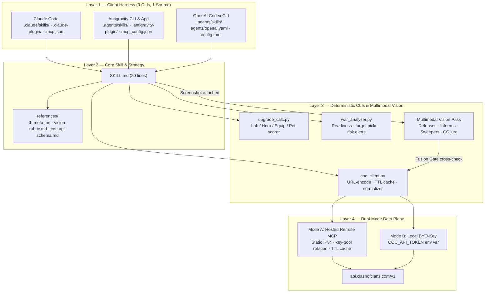
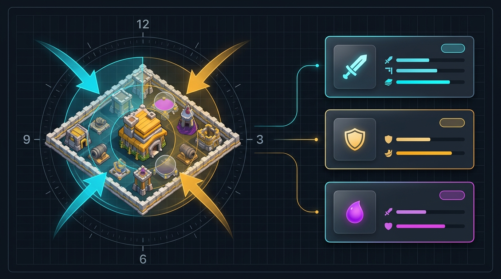

<div align="center">


# ⚔️ CoC Strategist (`coc-strategist`)

**Live Clash of Clans API data + Multimodal Base Vision Fusion for Upgrade Roadmaps, War Strategy, CWL Planning & Clock-Position Attack Plans**

[](https://www.python.org/)
[](LICENSE)
[](#-universal-installation-across-all-3-clis)
[](https://developer.clashofclans.com)

</div>

---

## 🌟 Built to Work Effortlessly for Everyone

Whether you are a competitive **TH17 war caller**, a casual player trying to fix a **rushed village**, or a clan leader managing **15v15 / 30v30 CWL**, `coc-strategist` drops straight into **Claude Code**, **Google Antigravity (`agy`)**, and **OpenAI Codex CLI** from a single canonical source—zero duplicated files and zero setup friction.

- **Works with `#TAG` only, screenshot only, or both together:** Automatically switches between API-driven upgrade/war analysis and multimodal base reading.
- **Solves the Static-IP `403` Trap:** Supercell locks API tokens to static public IPv4 addresses (breaking on home Wi-Fi, VPNs, and mobile data). `coc-strategist` ships ready for a **Hosted Streamable-HTTP MCP Gateway** (Mode A) while fully supporting **local BYO-key** execution (Mode B).
- **80–90% Context Savings:** Normalizes bulky 15–50 KB player JSON payloads down to ~1.3–1.5 KB of pure tactical deltas (`deficit = maxLevel - level`), stripping maxed items.
- **Deterministic Math, Strategic AI:** All upgrade scoring, TH9–TH17 meta weighting, rate limiting, and war target matching run in black-box Python CLIs—the LLM focuses purely on strategy.
- **Zero-Crash Offline Fallback:** Gracefully handles missing `httpx`/`orjson` (built-in `urllib` + `json` fallbacks) and private war logs (automatic roster + war log fallback).

---

## 🧭 Architecture Overview



---

## 🎯 Multimodal Vision + Live API Fusion

<div align="center">



</div>

The official Clash of Clans API shows your **offense** (`heroes`, `heroEquipment`, `troops`, `spells`, `pets`), while screenshots reveal **base layout, Inferno modes, Sweeper angles, Eagle/Monolith placement, CC lureability, and wall tiers**.

1. **Branch 1 — Enemy War Base:** Extracts base topology via `references/vision-rubric.md`, cross-validates your actual unlocked/available troops via the **Fusion Gate** (never recommending locked or currently upgrading units), and writes a **clock-position phase-by-phase attack plan**.
2. **Branch 2 — Own Village / Builder:** Combines visible defense/wall progress and active builders with your live API deficits to produce a **prioritized Lab, Hero, Equipment & Pet roadmap**.

---

## 🚀 Universal Installation Across All 3 CLIs

| Platform / CLI | One-Line Install | Manual Trigger |
| :--- | :--- | :--- |
| **Claude Code** | `npx skills add shoto-c0de/coc-strategist -a claude-code` | `/coc-strategist` |
| **Antigravity (`agy`)** | `agy plugin install https://github.com/shoto-c0de/coc-strategist` | `/coc-strategist` |
| **OpenAI Codex CLI** | `npx skills add shoto-c0de/coc-strategist -a codex` | `$coc-strategist` |

### Codex MCP Configuration (`~/.codex/config.toml`)

```toml
[mcp_servers.coc-strategist]
url = "https://coc-mcp.yourhost.dev/mcp"
```

### Manual Clone Installers (Creates Symlinks / Junctions + Python Deps)

- **macOS / Linux:**
  ```sh
  git clone https://github.com/shoto-c0de/coc-strategist.git
  cd coc-strategist
  ./scripts/install.sh
  ```
- **Windows PowerShell (No Admin Required):**
  ```powershell
  git clone https://github.com/shoto-c0de/coc-strategist.git
  cd coc-strategist
  .\scripts\install.ps1
  ```

---

## ⚡ 60-Second Onboarding Flow

```text
1. User runs: npx skills add shoto-c0de/coc-strategist
   (or: agy plugin install https://github.com/shoto-c0de/coc-strategist)

2. Skill auto-discovers in their CLI session.

3. User types: "Check my CoC account #2PP and suggest upgrades"
   (or: /coc-strategist #2PP)

4. Skill activates → coc_client.py player #2PP → compact JSON → upgrade_calc.py
   → Agent generates ranked Upgrade Report.

5. User attaches enemy base screenshot:
   "Plan an attack on this base with my troops"

6. Vision pass extracts base topology → API validates troop levels
   → Agent generates tailored Attack Plan with clock-position deployment.
```

---

## 💬 Try It Now

Prompt any connected agent with:

```text
/coc-strategist #2PP
```

Or run the deterministic pipeline locally with your own Supercell token (**Mode B**):

```sh
export COC_API_TOKEN="eyJ..."

# Player profile → Ranked Lab, Builder/Hero/Equip/Pet Upgrade Report
python skills/coc-strategist/scripts/coc_client.py player "#2PP" | \
  python skills/coc-strategist/scripts/upgrade_calc.py --focus war --builders 6

# Live war board → Roster readiness, target picks, and risk alerts
python skills/coc-strategist/scripts/coc_client.py war "#2CJV99" | \
  python skills/coc-strategist/scripts/war_analyzer.py --attacker-tag "#2PP"
```

---

## 📊 Sample Output Cards

<details>
<summary><b>🏰 Sample Upgrade Report Output</b></summary>

```markdown
## 🏰 Upgrade Report — Warrior (TH16)

### ⚗️ Top 3 Lab Upgrades
| # | Troop/Spell | Current | TH Cap | Deficit | Meta Weight | Priority |
|---|-------------|---------|--------|---------|-------------|----------|
| 1 | Root Rider  | Lv 2    | Lv 3   | 1       | ⭐⭐⭐      | 🔴 HIGH  |
| 2 | Overgrowth  | Lv 2    | Lv 4   | 2       | ⭐⭐⭐      | 🔴 HIGH  |
| 3 | Electro Titan | Lv 2  | Lv 3   | 1       | ⭐⭐⭐      | 🟡 MED   |

### 🔨 Top 3 Builder Upgrades
| # | Target             | Current | Cap | Deficit | Priority |
|---|--------------------|---------|-----|---------|----------|
| 1 | Barbarian King     | Lv 90   | 95  | 5       | 🔴 HIGH  |
| 2 | Giant Gauntlet     | Lv 22   | 27  | 5       | 🔴 HIGH  |
| 3 | Spirit Fox         | Lv 8    | 10  | 2       | 🟡 MED   |

### 💎 Resource Forecast
- Dark Elixir needed: ~380K (King) + ~220K (Lab) = **~600K total**
- Shiny Ore: ~1,200 (Gauntlet upgrades)
- Builder time: ~32 days across 2 builders
```

</details>

<details>
<summary><b>⚔️ Sample Attack Plan Output</b></summary>

```markdown
## ⚔️ Attack Plan — vs TH16 Base

### 🎯 Base Read
- Infernos: 2× Multi (anti-swarm → avoid mass Witches)
- Sweepers: Both facing 3 o'clock (safe air entry: 9 o'clock)
- CC: Centralized, hard to lure (bring Poison)

### 🪖 Army Composition (validated to YOUR levels)
| Unit           | Count | Your Level | Required |
|----------------|-------|------------|----------|
| Root Rider     | 7     | Lv 2 ✅    | Lv 1+    |
| Electro Titan  | 3     | Lv 2 ✅    | Lv 1+    |
| Healer         | 4     | Lv 7 ✅    | Lv 5+    |
| Wizard         | 3     | Lv 11 ✅   | Lv 9+    |
| **Siege:** Log Launcher | — | Lv 4 ✅ | Lv 3+ |

### 🧪 Spells: 3 Rage · 2 Heal · 1 Freeze · 1 Overgrowth · CC: Poison

### 📍 Phase-by-Phase Plan
1. **Funnel (11–1 o'clock):** 2 Wizards + Baby Dragon on each corner
2. **Entry (12 o'clock):** Log Launcher → all Root Riders + E-Titans behind
3. **Hero Deploy:** King + Queen behind Root Riders, Warden ability on core entry
4. **Core (Rage + Heal):** Overgrowth on Eagle compartment, Rage bulk through core
5. **Cleanup:** RC dive to opposite side, Freeze last Inferno
```

</details>

---

## 🌐 Deploying the Hosted MCP Server (Mode A)

The `mcp-server/` folder ships a dependency-free Streamable-HTTP MCP server (`POST /mcp`, JSON-RPC 2.0) with key-pool rotation (`COC_API_KEYS`), per-endpoint TTL caching, 8 RPS upstream throttling, and 30 req/min per-IP protection.

| MCP Tool | Input | Output |
| :--- | :--- | :--- |
| `coc_get_player` | `tag: str` | Compact tactical player JSON (~1.5 KB) |
| `coc_get_player_battlelog` | `tag: str` | Last 25 battles + army composition signatures |
| `coc_get_clan_summary` | `tag: str` | Clan stats + Town Hall distribution histogram |
| `coc_get_clan_members` | `tag: str` | Sorted roster with upgrade readiness scores |
| `coc_get_war_board` | `clan_tag: str` | Live war state, remaining attacks, opponent TH spread |
| `coc_get_cwl_group` | `clan_tag: str` | CWL group clans, round results, mismatch risk |

Deploy to **Fly.io** with a dedicated static IPv4 (required by Supercell JWT keys):

```sh
cd mcp-server
fly launch --no-deploy
fly ips allocate-v4
fly secrets set COC_API_KEYS="eyJ_key1,eyJ_key2"
fly deploy
```

Then point `mcp_config.json`, `.mcp.json`, and `~/.codex/config.toml` to `https://<your-app>.fly.dev/mcp`.

---

## 🧪 Offline Verification

All normalizer, upgrade scoring, and war analysis tests run completely offline against frozen fixtures in `tests/fixtures/`:

```sh
python -m pytest tests/ -q
```

---

## Implementation Assumptions

1. **Missing `COC_API_TOKEN` exit code & tag case normalization:** When neither `--token` nor `COC_API_TOKEN` is set, `coc_client.py` prints an explanatory error to `stderr` and exits with code `1`. Lowercase input tags are uppercased before matching `^#[0289CGJLPQRUVY]{3,12}$`.
2. **429 retry count:** `max 3 attempts` in §4 is implemented as 3 total HTTP attempts (1 initial attempt plus up to 2 exponential-backoff retries with jitter).
3. **Maxed heroes with unmaxed equipment:** Per §6 Rule 1, heroes with `level == maxLevel` are omitted from `heroes[]`; any unmaxed equipment on those heroes or in top-level `heroEquipment[]` is retained in `heroEquipment[]` so upgrade recommendations do not drop unmaxed gear.
4. **Private war log fallback payload:** On HTTP `403 accessDenied` (non-IP mismatch) for `war`, `coc_client.py` fetches `/clans/{tag}`, `/clans/{tag}/members`, and `/clans/{tag}/warlog` (gracefully handling if `/warlog` is also private) and emits a compact JSON payload with `"privateWarLog": true` before exiting `10`.
5. **Disk cache payload:** Files under `~/.cache/coc-strategist/` store `{ "ts": <epoch>, "data": <raw_api_json> }` so `--raw` and normalized queries share cached responses cleanly.
6. **`upgrade_calc.py` `--lab-available` & heuristic forecasts:** `--lab-available` defaults to `true` and accepts either a bare flag or `true|false`. Resource forecasts (Dark Elixir, Shiny Ore, Starry Ore, builder days) are heuristic TH-scaled estimates marked `approximate: true`. Under `--focus cwl`, core TH-meta items receive the `+2.0` urgency bonus when `upgrading` flags are absent; under `--focus rush-fix`, items score by `deficit * (2.0 + deficit / cap) + 0.25 * meta_weight`.
7. **`war_analyzer.py` input & readiness handling:** Accepts both compact normalized war JSON (`coc_client.py war`) and raw `/currentwar` JSON (`tests/fixtures/war_inprogress.json`). Because `/currentwar` omits hero levels, `avgHeroLevel` displays `N/A` unless provided and `maxedPct` falls back to 3-star hit percentage. Target picking filters to `attacker_th >= defender_th` when any open base (`bestStars < 3`) qualifies, preferring closest TH band and lowest `remainingStars = 3 - bestStars`.
8. **MCP server transport & Dockerfile:** `mcp-server/server.py` uses stdlib `ThreadingHTTPServer` (`POST /mcp` JSON-RPC 2.0, `GET /health`) with `X-Forwarded-For` awareness for the 30 req/min per-IP limiter. `Dockerfile` runs `python:3.12-slim` with stdlib fallbacks (`urllib.request`, `json`) since `mcp-server/` has no separate `requirements.txt`.
9. **Windows `install.ps1` junction target resolution:** Because `cmd /c mklink /J` resolves relative targets against the current working directory rather than the link's parent folder, `scripts/install.ps1` changes into `.agents\skills` and `.claude\skills` before invoking `cmd /c mklink /J coc-strategist ..\..\skills\coc-strategist`.

---

## 📄 License

[MIT](LICENSE)
